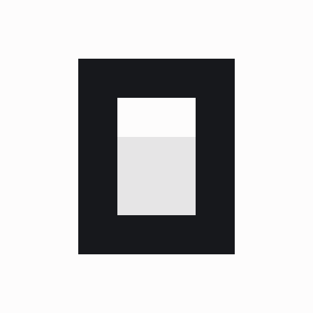
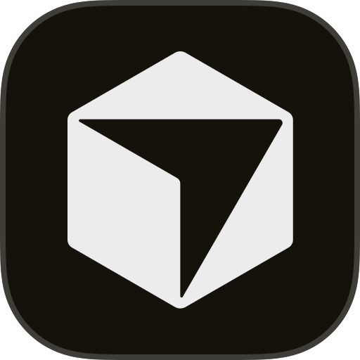
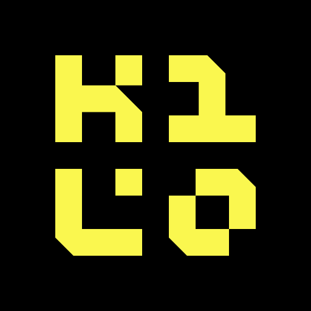
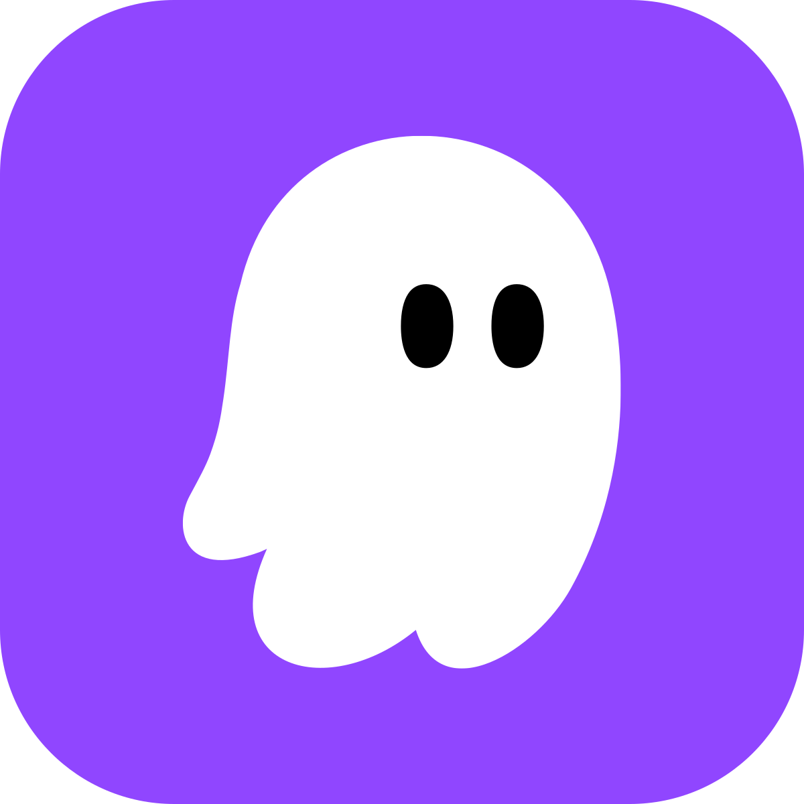
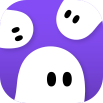

# agentkit

[](https://github.com/VladButacu/agentkit/actions/workflows/ci.yml)
[](LICENSE)

One repository that configures the coding agents on your machine. It carries
the shared agent instructions, a set of baseline skills, a collection of
third-party plugins, and one installer that wires all of it into whichever
tools are installed.

## Supported tools

| Tool | Skills | Native plugins | Plugin paths | Instruction file | Update hook | Custom agent |
| --- | :---: | :---: | :---: | :---: | :---: | :---: |
| <picture><source media="(prefers-color-scheme: dark)" srcset="assets/logos/codex-dark.svg"></picture> **Codex** | ✅ | ✅ | | ✅ | | |
|  **Claude Code** | ✅ | ✅ | | ✅ | ✅ | |
|  **OpenCode** | ✅ | | ✅ | | | |
|  **Cursor** | ✅ | | | | | |
|  **Kilo Code** | ✅ | | | | | |
|  **Kiro IDE** | ✅ | | | | | |
|  **Kiro CLI** | ✅ | | | | | ✅ |
|  **Kiro Crew** | ✅ | | | | | |

Skills for Kiro Crew are linked through its `extra_paths`. Codex and Claude Code both receive this repository's `AGENTS.md` as their instruction file, with Claude Code reading it through `CLAUDE.md`.

## Quick start

Paste this into your coding agent:

```text
Install agentkit from github.com/VladButacu/agentkit and follow its README.
```

The agent stops at two decisions. The terminal installer asks the same questions.

- **Plugins.** The third-party plugins are optional. Each one's role is listed in `plugins/manifest.json`. A terminal install prompts for each plugin. An agent-driven install stops and prints the same question until `--plugins` answers it: `--plugins superpowers,ponytail`, `--plugins all` or `--plugins none`. The choice is saved to `~/.local/state/agentkit/plugins.json` and reused on later runs.
- **Mode.** The full setup clones the repository and runs `sh install.sh`, which wires every tool found on the machine. Every path the installer writes is derived from the clone's location, so the wiring follows the clone. If you move the clone, rerun `install.sh`. A plugin-only install skips the clone and lets the tool manage updates.

Plugin-only install:

```sh
claude plugin marketplace add VladButacu/agentkit
claude plugin install agentkit@agentkit
```

Full setup:

```sh
git clone https://github.com/VladButacu/agentkit ~/agentkit
sh ~/agentkit/install.sh
```

> **Limits.** A plugin-only install reaches Claude Code and Codex only. Kiro IDE, Kiro CLI, Kiro Crew, Cursor, Kilo Code and OpenCode need the full setup.
>
> **Do not combine the modes.** Both deliver the same skills, so uninstall the plugin before running the full installer.

Requirements: git and Python 3.11 or later, on macOS or Linux. The installer detects which tools are installed and touches only those.

## What the installer changes

- Repository skills are symlinked into `~/.agents/skills` (read by Codex, Cursor, Kilo Code and OpenCode) and `~/.claude/skills` (Claude Code).
- Plugins from `plugins/manifest.json` are installed as native plugins in Codex and Claude Code where the tool supports it. Other tools get the plugin's skills linked in. Plugin checkouts live under `~/.local/share/agentkit/plugins/`.
- The Desloppify CLI is installed into an isolated venv when no `desloppify` executable exists.
- `AGENTS.md` from this repository is symlinked as the Codex and Claude Code instruction file, unless you already have your own.
- Claude `skillOverrides` entries that hide repository skills are removed.
- A Claude Code `SessionStart` hook runs the update check. At each session start it fetches `origin` at most once a day and prints a notice when the clone is behind upstream. Code you pull into the clone therefore runs automatically in Claude sessions. Delete the `SessionStart` entry in `~/.claude/settings.json` at any time, or run the uninstall below.

The installer never replaces files or links it does not own, never disables or upgrades an enabled native plugin, and never forces a trust decision. Anything needing your attention is printed as a `PENDING` line. Every JSON config it rewrites is backed up to `~/.local/state/agentkit/backups/` first.

## Skills and plugins

Baseline skills live in `skills/<name>/SKILL.md`. Each has one job, stated in its description. No two skills claim the same job.

| Plugin | Role | Install |
| --- | --- | --- |
| Superpowers | planning, TDD, debugging, review, branch delivery | native plugin in Codex and Claude Code, skills elsewhere |
| Ponytail | smallest complete implementation, YAGNI | native plugin in Codex and Claude Code, skills elsewhere |
| FEX | frontend design and quality orchestration | native plugin in Codex and Claude Code only |
| Desloppify | codebase health scans and the cleanup queue | skill everywhere, CLI installed when missing |

Each manifest entry is a repository URL plus what the plugin provides: `marketplace` (native plugin), `skills` (linked into tools without native plugins), `opencode` (plugin path registration) and `cli` (command-line tool). `plugins/manifest.schema.json` documents and validates the shape.

There are no versions to manage. Rerunning the installer fetches each plugin's current upstream HEAD and repoints everything the installer manages, so upstream changes apply on the next run without a per-change review. Trust the plugin authors accordingly. Native plugins in Codex and Claude Code follow their own marketplace lifecycle and are never upgraded or replaced here. To see what a checkout holds, run `git -C ~/.local/share/agentkit/plugins/<name> log -1`.

## Keeping current

Rerun the update to pull the clone and reinstall with your remembered plugin selection:

```sh
make -C ~/agentkit update
```

The session hook described above prints the notice that tells you when to run it. Other tools have no equivalent hook, so poll manually or wire your own.

Plugin-only installs update through their tool. Claude Code updates plugins itself, and Codex refreshes them with `codex plugin marketplace upgrade`.

## Personal layer and project conventions

Machine-specific content, such as cluster names, personal budgets and voice defaults, lives in an untracked `AGENTS.local.md` next to `AGENTS.md`. The agent reads it when present.

The `repo-bootstrap` skill applies the same layout to any project repository. `AGENTS.md` is the single rulebook. `CLAUDE.md` is one pointer line. Skills live only in `.agents/skills/`, with tool directories symlinked to it. `AGENTS.local.md` is gitignored for per-machine overrides.

## Uninstall

```sh
make -C ~/agentkit uninstall
```

This removes every skill link, instruction symlink, manifest entry and session hook the installer created. Your own files and hooks stay untouched. The caches under `~/.local/share/agentkit` and `~/.local/state/agentkit` (which hold your config backups) and the clone itself stay for you to delete. A plugin-mode install is removed by its tool, for example `claude plugin uninstall agentkit`.

## Developing

`make test` runs the full gate in order. It lints the Python sources with ruff, then runs the installer tests (isolated filesystems, no network, no agent launches) and the prose linter tests. CI runs the same gate on Ubuntu and macOS.

## License

MIT licensed. See `LICENSE`. Skills adapted from third-party work keep their upstream notices in `THIRD-PARTY-NOTICES.md` and in per-skill `LICENSE` files.
