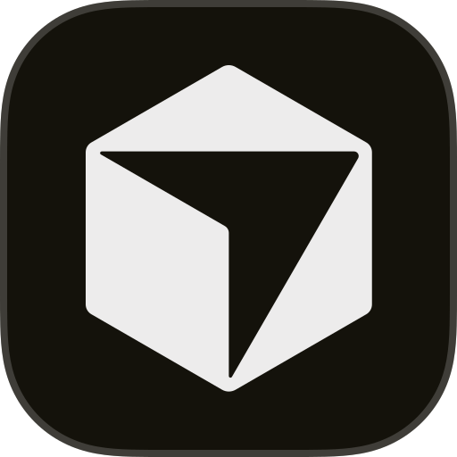
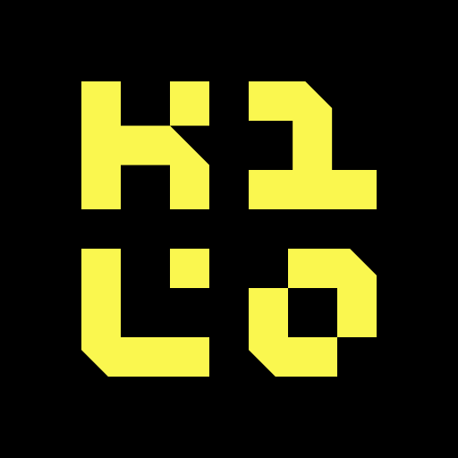
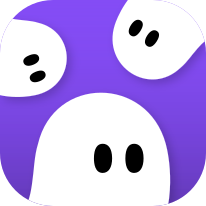

# agentkit

[](https://github.com/VladButacu/agentkit/actions/workflows/ci.yml)
[](https://scorecard.dev/viewer/?uri=github.com/VladButacu/agentkit)
[](LICENSE)

**agentkit** gives every coding agent on your machine the same instructions, skills and plugins.

Edit a rule or a skill once, in this repository. Each installed tool then receives it in the form it already reads. Tools that are not installed get nothing.

## Supported tools

| Tool | Skills | Native plugins | Plugin paths | Instruction file | Update hook | Subagents | Custom agent |
| --- | :---: | :---: | :---: | :---: | :---: | :---: | :---: |
| <picture><source media="(prefers-color-scheme: dark)" srcset="assets/logos/codex-dark.svg"></picture> **Codex** | ✅ | ✅ | | ✅ | | ✅ | |
|  **Claude Code** | ✅ | ✅ | | ✅ | ✅ | ✅ | |
|  **OpenCode** | ✅ | | ✅ | | | ✅ | |
|  **Cursor** | ✅ | ✅ | | | | ✅ | |
|  **Kilo Code** | ✅ | | | | | ✅ | |
|  **Kiro IDE** | ✅ | | | | | ✅ | |
|  **Kiro CLI** | ✅ | | | | | ✅ | ✅ |
|  **Kiro Crew** | ✅ | | | | | | |

## Install

Requires git and Python 3.11 or later, on macOS, Linux or Windows.

Ask your coding agent to do it:

```text
Install agentkit from github.com/VladButacu/agentkit and follow its README.
```

Or run it yourself. On macOS and Linux:

```sh
git clone https://github.com/VladButacu/agentkit ~/.agentkit
sh ~/.agentkit/install.sh
```

On Windows, in PowerShell:

```powershell
git clone https://github.com/VladButacu/agentkit $HOME\.agentkit
py $HOME\.agentkit\scripts\install.py
```

### Install questions

The installer asks up to three questions and remembers the answers.

When an agent runs the installer, the installer stops at each question. The agent then reruns it with the matching flag.

| Question | Flag |
| --- | --- |
| Which optional plugins and features to install, including the Obsidian knowledge vault. Superpowers is required and always installed. A plugin added in an update is asked about once | `--plugins ponytail,obsidian`, `all` or `none` |
| With the Obsidian feature: which agent CLI and model run the nightly vault dream, and when | `--dream codex --dream-model <id> --dream-time 03:00`, `--dream-command '<command>'` or `--dream none` |
| What to do with an `AGENTS.md` or `CLAUDE.md` you already wrote | `--instructions keep`, `append` or `replace` (yours is backed up first) |

Any clone location works. To limit the install to some tools, pass `--tools codex,claude`. If you move the clone, run the installer again.

### How agentkit itself is delivered

The full installer also installs agentkit's own skills through each tool's native plugin channel, where the tool has one:

- Claude Code and Codex get a marketplace install.
- Cursor gets a clone pinned to your release tag at `~/.cursor/plugins/local/agentkit`. Then run Developer: Reload Window.

These tools version the skills themselves, show their own update notices, and list agentkit in `/plugin` like any other plugin.

One rule guards the shared skills root. Codex or Cursor gets the native channel only when no other installed tool also reads `~/.agents/skills`. Otherwise a native plugin and the shared root would load every skill twice. In that case the installer says so and uses links instead. Pass `--delivery links` to opt out everywhere.

To install only the plugin, without instruction files, third-party plugins or other tools, run these by hand:

```sh
# Claude Code
claude plugin marketplace add VladButacu/agentkit
claude plugin install agentkit@agentkit

# Cursor: clone into the local plugin folder, then run Developer: Reload Window
git clone https://github.com/VladButacu/agentkit ~/.cursor/plugins/local/agentkit
```

## What the installer changes

| What | Where |
| --- | --- |
| Skills | Linked into each installed tool's skills folder: `~/.agents/skills` for Codex, Cursor, Kilo Code and OpenCode, `~/.claude/skills`, `~/.kiro/skills`, and Kiro Crew's `extra_paths` |
| Subagents | Each agent in `agents/`, written in the tool's own format to `~/.codex/agents`, `~/.kiro/agents`, `~/.config/opencode/agents` and `~/.config/kilo/agents`, and to `~/.claude/agents` and `~/.cursor/agents` unless the native plugin carries them. No copy names a model |
| Instructions | A marked `agentkit:begin` block in `~/.claude/CLAUDE.md` that imports this repository's `instructions/global.md`, and a copy in `~/.codex/AGENTS.md` |
| Plugins | Native plugins in Codex and Claude Code, linked skills elsewhere, checkouts in `~/.local/share/agentkit/plugins/` |
| Desloppify CLI | An isolated venv, only when `desloppify` is not already installed |
| Self-delivery | agentkit's own skills as a native plugin in Claude Code and Codex and a pinned clone in `~/.cursor/plugins/local/agentkit`, or plain links; the resolution is remembered in `~/.local/state/agentkit/delivery.json` |
| Plugin pins | The commit each third-party checkout resolved to, in `~/.local/state/agentkit/checkouts.json` |
| Update hook | A Claude Code `SessionStart` hook that checks once a day for a newer release tag, prints the notice and shows one operating-system notification |
| Python launcher | `~/.local/share/agentkit/bin/python`, which every hook and schedule below starts. It picks the first Python 3.11 or later each time, so upgrading Python breaks nothing |
| Vault hooks | With the Obsidian feature: lifecycle hooks in Claude Code, Codex, Cursor, Kiro CLI and Kiro Crew, and the nightly dream in launchd, a systemd user timer or Task Scheduler |
| Claude settings | Removes `skillOverrides` entries that hide agentkit skills |

Links are symlinks on macOS and Linux, and directory junctions on Windows. Neither needs admin rights. Where no link can be made, the skill is copied and refreshed on every run.

The installer only replaces files and links it created. It backs up every file it rewrites to `~/.local/state/agentkit/backups/`. It prints a `PENDING` line for anything that needs you.

### Things to know

- The update hook runs code from the clone in your Claude sessions. Whatever you pull into the clone therefore runs in those sessions. To turn the hook off, delete its entry in `~/.claude/settings.json`.
- Uninstalling removes a native agentkit plugin through its tool's own plugin command. It also deletes the Cursor clone the installer created.

## Skills

Each skill lives in `skills/<name>/SKILL.md` and has one job. An agent loads a skill when its description matches the task.

Five skills run only when you name them: `desloppify`, `makefile-generator`, `pyproject-generator`, `repo-bootstrap` and `ship`.

| Skill | What it does |
| --- | --- |
| `codebase-design` | Shapes module interfaces, boundaries and test seams, and untangles tightly coupled code |
| `desloppify` | Runs Desloppify health scans and works through the cleanup queue |
| `domain-modeling` | Settles ambiguous domain terms, keeps a project glossary and records architecture decisions |
| `makefile-generator` | Creates or standardizes a Makefile for Python, MCP, Node.js/Electron or Java/Gradle projects |
| `prose` | Drafts or revises anything a person reads, with an evidence pass and a voice pass |
| `pyproject-generator` | Creates or standardizes `pyproject.toml` for Python libraries, services, MCP servers or Electron backends |
| `release-notes` | Turns a changelog entry into user-facing release notes |
| `repo-bootstrap` | Sets up a project repository with `AGENTS.md` as the rulebook, a one-line `CLAUDE.md`, skills in `.agents/skills/` and a gitignored `AGENTS.local.md` |
| `research` | Investigates a question across primary sources, delegating where it helps |
| `retro` | Reviews a coding session for recurring mistakes and friction, and proposes fixes to the setup |
| `ship` | Takes the current changes through branch, gate, commit, push and pull request, then watches CI and fixes failures. Stops before merge |
| `to-tickets` | Publishes an approved plan as tracker issues or local tickets with acceptance criteria and dependencies |
| `writing-for-agents` | Improves `AGENTS.md`, `CLAUDE.md` and other agent-facing documents |

## Subagents

| Subagent | What it does |
| --- | --- |
| `blind-reviewer` | Judges an artifact against a rubric without seeing the conversation that produced it, with read-only tools. `prose`, `desloppify` and `vault-lint` dispatch it |
| `scout` | Reads a lot of code, logs or notes with read-only tools and returns a cited summary, so the raw reading stays out of the caller's context. `retro`, `to-tickets`, `vault-recall`, `vault-prune` and `vault-dream` dispatch it |

Each subagent runs on the model of the session that dispatches it.

In Codex, subagents have no shell. They stay read-only through their instructions alone, because a Codex agent cannot narrow its parent's sandbox.

## Plugins

The third-party plugins are listed in `plugins/manifest.json`:

| Plugin | Role | Install |
| --- | --- | --- |
| Superpowers | planning, TDD, debugging, review, branch delivery; required, because agentkit's skills hand work to it | native plugin in Codex and Claude Code, skills elsewhere |
| Ponytail | smallest complete implementation, YAGNI | native plugin in Codex and Claude Code, skills elsewhere |
| FEX | frontend design and quality orchestration | native plugin in Codex and Claude Code only |
| Desloppify | the CLI behind the `desloppify` skill | installed when no `desloppify` executable exists |

- A checkout follows its upstream unless the manifest pins a `ref`, such as `"ref": "v2.1.0"`. The commit each checkout resolved to is recorded in `~/.local/state/agentkit/checkouts.json`.
- Native plugins in Codex and Claude Code update through their own marketplace.
- To add a plugin, read the fields in `plugins/manifest.schema.json`. An unpinned plugin means you trust its author's current upstream.

### Obsidian knowledge vault

Choosing `obsidian` installs six agentkit skills from `features/obsidian/`, along with the vault's hooks and nightly dream. It is an agentkit feature, not a third-party plugin.

| Skill | What it does |
| --- | --- |
| `vault-setup` | Creates or adopts the vault: layout, conventions file, templates, git and the path in `AGENTS.local.md` |
| `vault-capture` | Files decisions, findings and sources into the vault and links them into existing notes |
| `vault-recall` | Answers from the vault with citations before an agent researches from scratch |
| `vault-lint` | Checks the vault for orphans, missing properties, duplicates and stale claims, and proposes convention changes |
| `vault-prune` | Finds notes that no longer hold, keeps the ones that do and proposes retiring the rest. Retired notes move to `90 System/Archive/` with their history |
| `vault-dream` | Files what recent sessions learned that nobody captured, corrects drifted notes and keeps the index small |

The vault is a plain folder of Markdown in its own git repository. It is `~/knowledge` unless `AGENTS.local.md` names another path, and it opens on `Home.md`.

| Area | What it is for you |
| --- | --- |
| `Home.md` | Your start page, bookmarked in Obsidian. **Needs you** lists what agents filed on their own: tick `approved` to accept an item, or delete it to reject it. Below it are recent notes, categories and the current focus. The optional community plugin Homepage opens it at every launch |
| `00 Inbox/` | Notes and proposed merges, deletions or edits that wait for your approval |
| `10 Notes/` | The knowledge itself |
| `20 Categories/` | One hub per category, listing its notes |
| `30 Clippings/`, `40 Daily/` | Your sources and daily notes, which agents leave alone |
| `90 System/` | Templates, views, attachments, the agents' log and `Archive/` for retired notes |

Agents edit the files directly. While Obsidian is running, they use the Obsidian CLI for backlinks and link-safe renames. The vault's own `AGENTS.md` holds its conventions, which you and your agents extend together.

Agents use the vault without being reminded:

| When | What happens | Tools |
| --- | --- | --- |
| A session starts | The session learns where the vault is, what it is for, the index in `Home.md` and the latest `log.md` entries | Claude Code, Codex, Cursor, Kiro CLI, Kiro Crew |
| You send a prompt | Notes whose names or descriptions match the prompt are pointed out, found by a local keyword search with no model call | Claude Code, Codex, Kiro CLI, Kiro Crew |
| Every night | The dream reads a digest of the day's Claude Code, Codex and Kiro sessions, applies what you approved (including archiving the notes you approved for retirement), files what the sessions missed into `00 Inbox/`, tidies the vault and commits | Whichever agent CLI you chose |

### Notes on the dream

- You pick the agent CLI and model that run the dream: `claude`, `codex`, `opencode`, `kilo`, `kiro-cli` or `cursor-agent`.
- For any other headless agent, pass `--dream-command`. It receives the prompt as its last argument, or in place of `{prompt}`.
- Your operating system's scheduler starts the dream. Each run uses that model's credits.
- The log is `~/.local/state/agentkit/vault/dream.log`.
- Codex asks you to trust new hooks once, in `/hooks`.
- OpenCode and Kilo Code get the skills but no hooks.

## Update and uninstall

```sh
make -C ~/.agentkit update      # checkout the newest release tag and reinstall with your saved answers
make -C ~/.agentkit uninstall   # remove everything the installer created
```

An update pins the clone to the newest release tag. Sessions then run released content, not whatever `main` holds. Work between releases reaches you only through the next tag.

On Windows, update in three steps:

1. `git -C $HOME\.agentkit fetch --tags origin`
2. `git -C $HOME\.agentkit checkout --detach <tag>`, where the tag comes from `git describe --tags --abbrev=0 origin/main`
3. `py $HOME\.agentkit\scripts\install.py`

The Windows uninstall command is `py $HOME\.agentkit\scripts\install.py --uninstall`, and it removes everything the installer created.

A Claude Code session checks once a day for a newer release tag. When it finds one, it prints a notice and shows one operating-system notification. A successful install clears the cached notice.

Uninstalling leaves your own files and text in place. The one exception is an instruction file you chose to replace. The installer removes that file rather than restoring it, and your original stays in the backups folder. Plugin-only installs are removed by their tool, for example `claude plugin uninstall agentkit`.

## Developer machines

Develop the repository anywhere, for example `~/repos/agentkit`. Never wire a development clone into your tools. It runs unreleased code in every session. The installer warns when the tree is not at a release tag.

To also use agentkit as a consumer:

- Keep a second clone at `~/.agentkit`, pinned to a release tag, and install from there.
- Test unreleased work in throwaway sessions with `claude --plugin-dir ~/repos/agentkit`, or by running `make test`.

## Machine-specific notes

Put notes for one machine, such as cluster names or budgets, in `~/.config/agentkit/AGENTS.local.md`. Agents read the file in every session where it exists.

If the installer finds an `AGENTS.local.md` in the clone, it moves the file to that path.

## Contributing

[`CONTRIBUTING.md`](CONTRIBUTING.md) covers the test gate, pull request titles, the required commit sign-off and how releases are cut.

## License

MIT. Skills adapted from third-party work keep their notices in `THIRD-PARTY-NOTICES.md` and their own `LICENSE` files.
